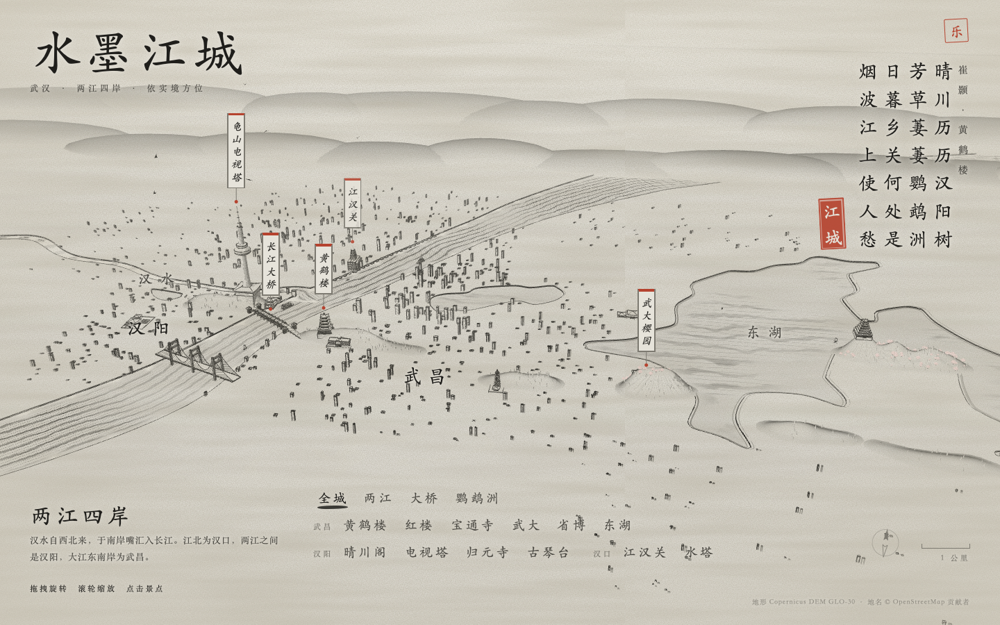
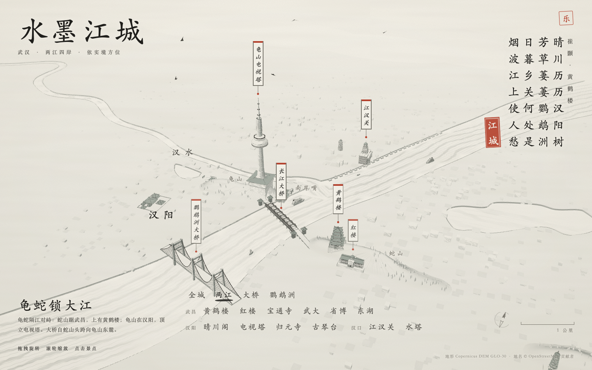
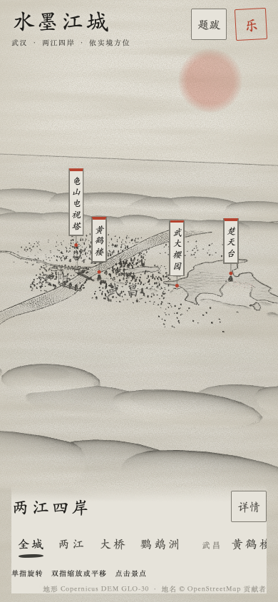
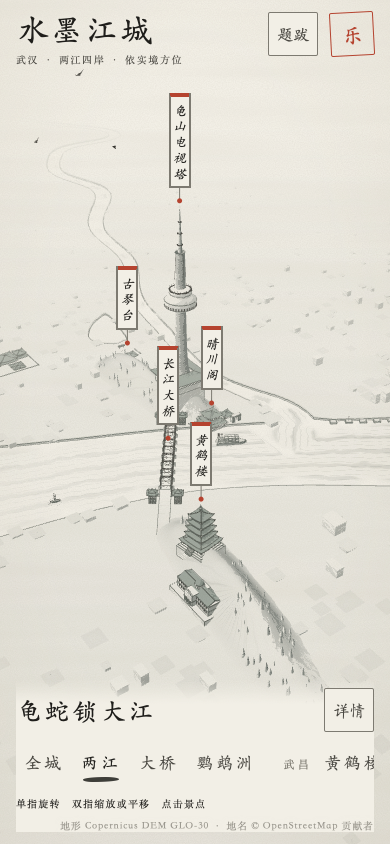
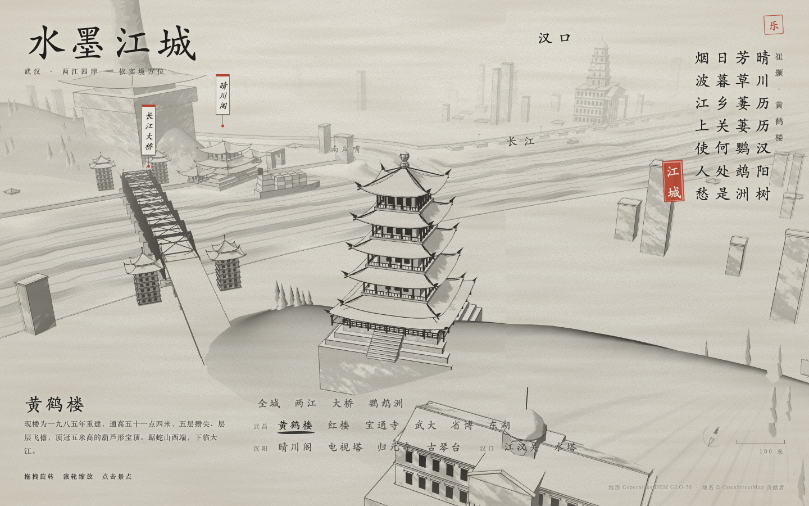
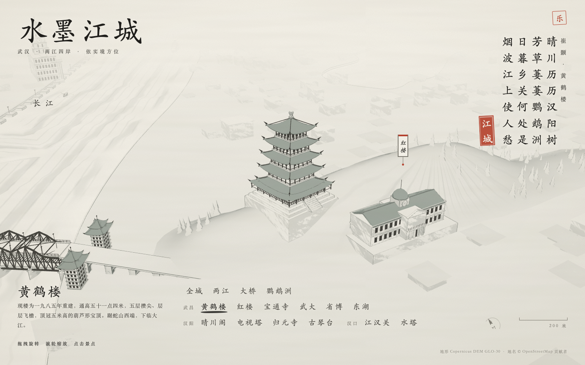
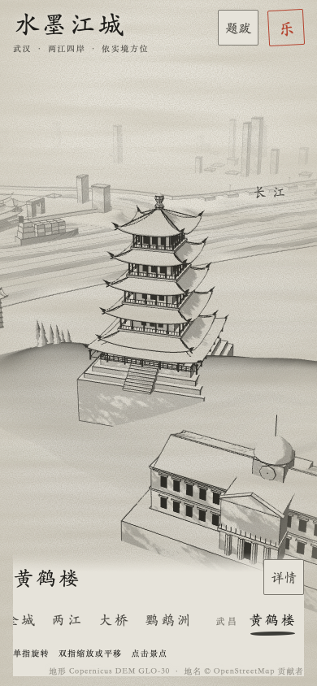
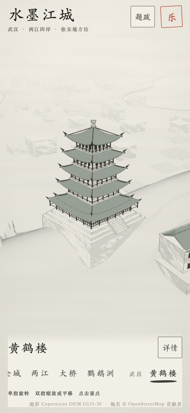

# 核心城区与黄鹤楼视觉样板

本轮交付是可操作的视觉样板，等待用户判断风格与构图，再决定其余景点是否逐一调整。未合并、未修改生产部署配置。

## 范围与视觉选择

- 默认打开「两江 · 龟蛇锁大江」，以黄鹤楼、长江大桥、晴川阁、龟山电视塔为核心。全城视角仍在导航首项，其他 15 个入口仍可访问。
- 桌面与手机采用不同核心城区观察方向；按各建筑的实际包围盒分别取景，避免把远处高塔的高度套到近处建筑上。桌面也为标题和底部说明留出空间。
- 黄鹤楼近景换到西南侧，减轻红楼占据手机前景的问题；完整楼体及台基进入可用画幅。
- 宣纸底色变亮，纸纹、暗角、远山和江面长线变淡；屋顶用较深墨色，墙基用浅色。背景随机楼群概括成低矮屋面，省去逐栋描边。
- 地标模型、经纬度、实测地形与河湖数据、音乐均未修改。共享材质与背景楼群会影响全城渲染，但本轮只为核心城区和黄鹤楼专门调整镜头，不代表全城逐景设计已经完成。
- 继续使用 Three.js r128 与现有依赖；未加入运行时库、图片资源或后期处理通道，不作性能提升的未经测量声明。

## 对照方式

基线：`fc6222f`（远程 master，包含真实地形 PR #7）。新版本：`codex/ink-city-visual-study`。

以下截图来自同一台 macOS 的 WebKit，桌面 1440×900，手机 390×844。两侧都使用锁定版本的本地 CDN 库、系统后备字体与减少动态效果，避免网络字体和动画时刻影响比较。首页对照包含有意的入口切换：旧版为全城，新版为核心城区。不是同机位材质对照。

| 画面 | 修改前 | 视觉样板 |
| --- | --- | --- |
| 桌面首页 |  |  |
| 手机首页 |  |  |
| 桌面黄鹤楼 |  |  |
| 手机黄鹤楼 |  |  |

复现：

```bash
npm run build
node tests/capture-visual-study.cjs webkit dist/index.html output/visual-study
node tests/capture-visual-study.cjs chromium dist/index.html output/visual-study
```

脚本每次等待就绪与两次绘制，并在截图时快进残留 CSS 过渡，使导航下划线稳定后截图；只用于开发，不进入单文件产物。清单记录浏览器版本、尺寸、页面标题与时间。基线用 `git archive fc6222f src build.sh` 导出到临时目录后构建，使用同一截图脚本指定该 HTML。

## 验证记录

- `npm test`：6/6 构建检查通过；浏览器完整运行 81/82 通过（WebKit 41/41，Chromium 40/41）。覆盖 16 个导航入口、加载故障、减少动态效果、手势中断、Tab/Enter、面板、缩放、五种屏幕尺寸及牌签避让。
- 首次 Chromium 的 `reduced motion switches instantly` 在就绪前失去 WebGL 上下文。追踪记录 `CONTEXT_LOST_WEBGL` 与驱动 `GPU stall due to ReadPixels`，页面进入已有失败提示；没有未捕获的 JS 异常。没有据此断言驱动的根因或修改产品容错。
- 保留失败追踪后，以 `DEBUG=pw:browser npx playwright test tests/browser/interaction.spec.cjs --project=chromium --grep 'reduced motion switches instantly' --repeat-each=3 --output=output/visual-study/context-recheck --reporter=list` 作三个独立启动复查：3/3 通过。源码、测试断言和超时均未为复查修改。82 个用例均已有通过记录，但不把首次完整运行记为全绿；这次瞬时图形异常仍是环境验证的限制。
- 新增首页行为检查：桌面和手机默认选中核心城区、黄鹤楼具有可辨认的屏幕尺寸、全城仍可返回、选中状态唯一。实现前两项首页测试均因默认选中全城而失败，修改后双浏览器通过。
- `node tests/capture-visual-study.cjs`：WebKit 26.5 基线与新版本共 8 张截图；Chromium 149.0.7827.55 新版本 4 张截图，无浏览器控制台错误。
- `node tests/live-smoke.cjs webkit` 与 `chromium`：直接打开单文件，四项真实 CDN 脚本均 HTTP 200，地图就绪、音乐启停通过，无未捕获异常。
- `git diff --check` 与截图脚本 `node --check` 通过。

## 评审与限制

本次为作者自审，比较 `fc6222f` 与本分支完整差异。重点检查预设与手动镜头切换、布局重新测量、焦点/隐藏牌签、共享材质影响及单文件构建；不替代用户的视觉验收。

没有物理手机验证。自动化 WebKit 不等同于 iOS Safari 真机，Chromium 的软件图形环境不代表实际设备帧率。字体后备截图用于稳定比较；真实 CDN 冒烟允许在线字体请求，但不作跨设备字体外观一致的保证。

方向仍是水墨微缩城市；未重做地标几何、未加入真实水彩扩散模拟。后续是否进一步塑造城市团块、树林和其他景点，应在这两组样板获得视觉反馈后决定。

## 回退与交付

所有源代码、测试和证据归于一个可整体回退的视觉样板提交。通过新的 revert 提交与 PR 回退，不重写已发布历史。master 保持基线，工作分支保留；视觉验收前保留 PR。
